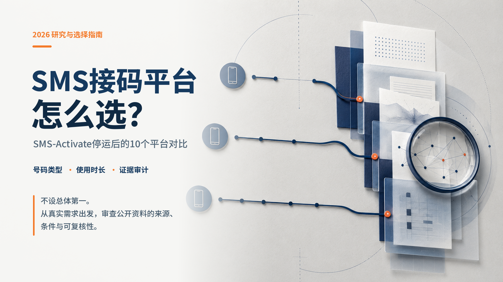
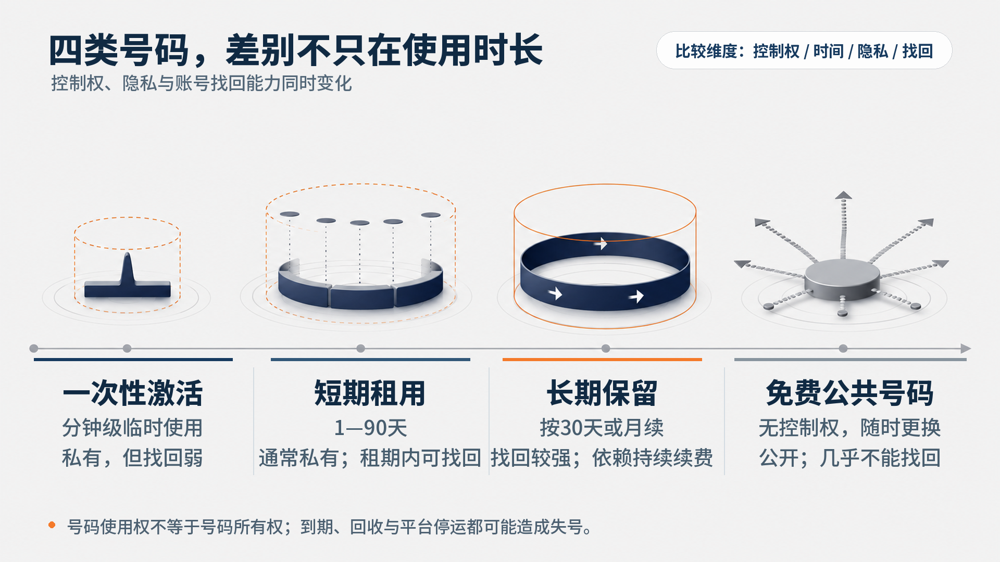
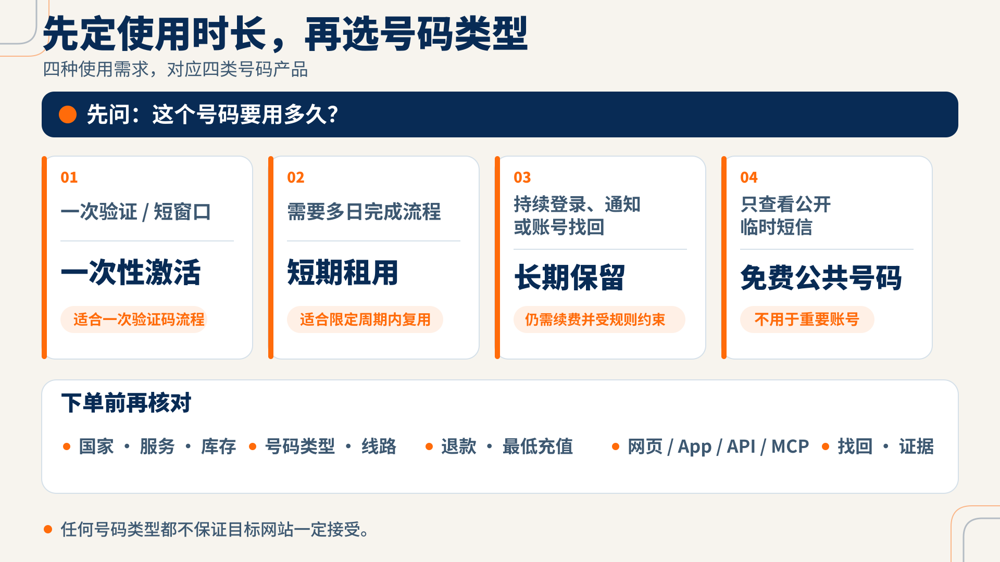
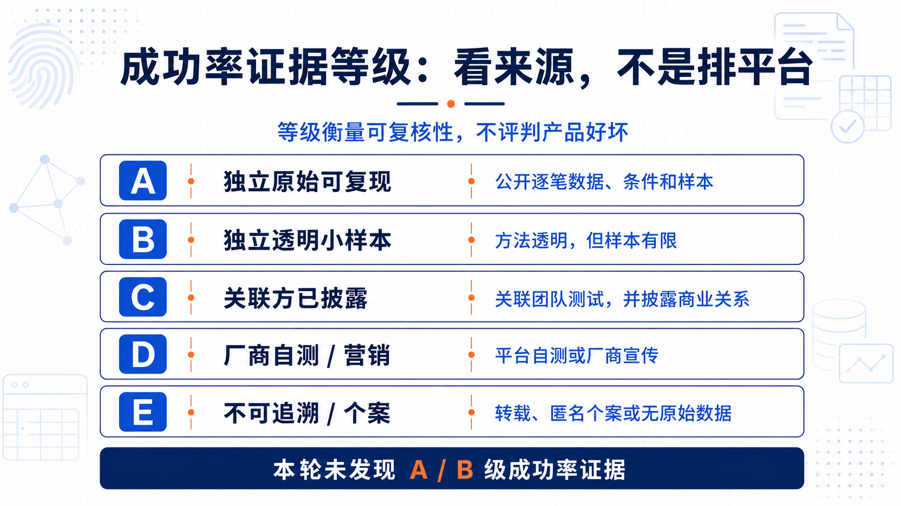

# 2026年SMS接码平台怎么选？SMS-Activate停运后的10个平台对比

*选择接码平台应同时看号码使用时长、控制权与公开证据质量。*

本文比较5sim、SMS-Man、SMSPool、TextVerified等10个平台的一次性号码、租用、退款、接口与公开成功率证据，帮助读者按场景选择。

## 2026年SMS接码平台推荐：不同需求的快速结论

**答案：本文不设总体第一：低价一次性看HeroSMS或5sim，美国验证看TextVerified，长期保号看TwoLine，开发接口按API或MCP需求选择。**

**证据：** 结论依据核验日的产品类型、价格、保留和接口资料；完整首选与备选见场景表。

**限制：** 动态价格随组合与库存变化；线路、国家数多为厂商声明，不能推出验证码必定成功。

### 研究说明

本文没有购买并逐一测试所有平台。产品事实依据官方页面；成功率来自公开测试与厂商材料，并标明发布者、样本和利益关系。平台链接均为普通链接，无联盟参数。

## 10个平台核心信息对比表

核验日期为2026年7月17日。价格、库存、国家数和支付入口可能变化。

### 产品与价格

| 平台 | 产品类型 | 号码来源声明 | 国家范围 | 参考起价 | 最低充值 |
|---|---|---|---|---|---|
| [5sim](https://5sim.net/) | 一次性激活；部分组合可接多条短信 | 官方称虚拟号码；未承诺全部真实SIM/non-VoIP | 营销页180+国；当日注册页153国、1215服务 | 服务列表最低 **USD 0.01/次**；营销文案另称 **USD 0.008起** | 未披露 |
| [SMS-Man](https://sms-man.com/) | 一次性；租用 | 官方称不绑定实体SIM的云号码 | 一次性200+国、1000+服务；租用16国 | **USD 0.05/次** | 未披露 |
| [SMSPool](https://www.smspool.net/en) | 一次性；长期租用；免费公共号 | 官方称仅non-VoIP；长期号称real non-VoIP | 官方称150+国、1200+服务 | **USD 0.02/次** | 未披露 |
| [TextVerified](https://www.textverified.com/) | 短信/语音验证；1—14天短租；可续长期租用 | 官方称美国实体SIM、non-VoIP | 仅美国号码；官方称900+服务 | **USD 0.25/次**；短租 **USD 1.50起**；续租 **USD 5/月起** | 未披露 |
| [HeroSMS](https://hero-sms.com/) | 一次性；Full rent库存 | physical与virtual混合；未承诺全部真实SIM/non-VoIP | 官方称180+国、700+服务 | 当日动态样本 **USD 0.006/次** | 最低充值随支付方式变化；统一公开下限未披露 |
| [GrizzlySMS](https://grizzlysms.com/) | 一次性 | 实际国家与USA virtual池并存 | 多国；服务搜索显示2425，稳定国家总数未披露 | 当日WhatsApp样本 **USD 0.013** | **USD 3** |
| [SMSPVA](https://smspva.com/) | 一次性；日/周/月租；免费公共号 | 官方称VoIP/虚拟号与真实SIM并存 | 主页面60+国；旧页100+ | **USD 0.05/次** | 统一下限未披露；仅部分银行卡渠道公开USD 5，不能外推 |
| [VirtualSMS](https://virtualsms.io/) | 一次性；1/3/7/14/30日专属租用；共享号 | 官方称真实实体SIM、non-VoIP | 官方称145+国、2500+服务；[租用页](https://virtualsms.io/rentals)当日可租6国 | 激活 **USD 0.05/次起**；租用页 **USD 4.99起**，首页另称 **USD 0.25/日起**、[关于页](https://virtualsms.io/about)称 **USD 2起** | 未披露 |
| [VerifySMS.app](https://verifysms.app/) | 按次虚拟号码 | 未承诺全部真实SIM/non-VoIP | 此前[Google Play官方页索引](https://play.google.com/store/apps/details?id=app.verifysms.android)称 **120+**（官网当前仍链接Android Google Play；本轮直开失败，未验证当前正文）；[官网](https://verifysms.app/)当前称 **150+**；[App Store](https://apps.apple.com/us/app/verify-sms-virtual-number/id6759080670)当前称 **200+国** | **USD 0.10/次** | 未披露 |
| [TwoLine](https://twoline.io/) | 月租第二号码；私有收件箱 | 未统一承诺non-VoIP或真实SIM | 美国、英国、荷兰 | 约 **USD 6.99 / USD 9.99 / USD 11.99每月** | 未披露 |

### 证据与适用场景

| 平台 | 失败退款 | API/MCP | 号码保留 | 公开成功率 | 等级 | 最适合 |
|---|---|---|---|---|---|---|
| 5sim | [取消或部分组合约5分钟未到码退余额；软件/API错误不退](https://5sim.net/rules) | [REST API](https://5sim.net/docs)；MCP：账本未披露 | 一次性，不用于长期复用 | [VerifySMS厂商比较稿](https://verifysms.app/blog/best-sms-verification-services-2026-mega-comparison/)称WhatsApp **65—88%**（总20次，子样本/国家未披露；D）；[TwoLine关联方测试](https://twoline.io/blog/we-tested-12-sms-verification-services-2026/)称美国 **6/10**、非美国 **8/10**（与每家n=10冲突；C） | C/D；无A/B | 低价全球一次性与API |
| SMS-Man | [限时未到码，取消后自动退；到码不退](https://sms-man.com/payment-policy) | [API v2、兼容API、Rent API](https://sms-man.com/api)；MCP：账本未披露 | 最长90天；官方称到期后不再售出 | [VerifySMS厂商比较稿](https://verifysms.app/blog/best-sms-verification-services-2026-mega-comparison/)称 **74%**（总20次，WhatsApp分母/国家未披露；D）；[TwoLine关联方测试](https://twoline.io/blog/we-tested-12-sms-verification-services-2026/)称美国 **5/10**、非美国 **7/10**（与每家n=10冲突；C） | C/D；无A/B | 一次性、租用和API并用 |
| SMSPool | [未到码不收费，款项留余额](https://www.smspool.net/article/how-to-request-a-balance-refund-on-smspool--484d70f56719) | [REST API](https://www.smspool.net/article/how-to-use-the-smspool-api-0dd6eadf4c) | 长期租用可续 | [VerifySMS厂商比较稿](https://verifysms.app/blog/best-sms-verification-services-2026-mega-comparison/)称 **71%**（总20次，子样本未披露；D）；[TwoLine关联方测试](https://twoline.io/blog/we-tested-12-sms-verification-services-2026/)称美国 **9/10**（n=10；C）；[VoidMob厂商稿](https://voidmob.com/blog/best-non-voip-sms-verification-services-2026)二手转述 **99% uptime**（无时间序列，非成功率；D） | C/D；无A/B | non-VoIP声明、长租与API |
| TextVerified | [到码才扣credits；未到可退](https://www.textverified.com/faq) | [REST API](https://www.textverified.com/automate) | 一次性会回收；长期号按30天续 | [VerifySMS厂商比较稿](https://verifysms.app/blog/best-sms-verification-services-2026-mega-comparison/)称 **82%**（总20次，子样本未披露；D）；[TwoLine关联方测试](https://twoline.io/blog/we-tested-12-sms-verification-services-2026/)称 **10/10**（n=10，无逐笔数据；C） | C/D；无A/B | 美国验证、短租或续租 |
| HeroSMS | [激活20分钟未到码退余额；租用仅前20分钟可退](https://hero-sms.com/rules) | [API入口](https://hero-sms.com/api) | 24小时至8周；续费规则未披露 | [VerifySMS厂商比较稿](https://verifysms.app/blog/best-sms-verification-services-2026-mega-comparison/)称 **72%**、总体 **85%**（总20次；曾为供应侧客户，子样本未拆；D） | D；无A/B | 动态低价一次性 |
| GrizzlySMS | [20分钟未到码退余额；到码不退](https://grizzlysms.com/faq) | [公开可读API文档](https://grizzlysms.com/docs)；官方文档直链[MCP Server (for AI)](https://github.com/GrizzlySMS-Git/grizzly-sms-mcp) | 签发20分钟，不再发放 | [VerifySMS厂商比较稿](https://verifysms.app/blog/best-sms-verification-services-2026-mega-comparison/)称 **78%**（总20次，overall/WhatsApp分母不清；D） | D；无A/B | 20分钟一次性与API/MCP接口 |
| SMSPVA | [未到码可在7天内申请退款](https://smspva.com/uploads/pdf/en/refund_policy.pdf) | [REST API、回调](https://smspva.com/help.html) | 数日、数周或数月；上限未披露 | [SMSPVA官网](https://smspva.com/)声称真实SIM号码 **99% delivery success rate**（无样本、条件或逐笔数据；D）；未发现可复核方法 | D；无A/B | 多档租期与回调API |
| VirtualSMS | [主口径20分钟未到码退余额](https://virtualsms.io/rentals)；[关于页另有2分钟版本](https://virtualsms.io/about) | [REST API+MCP](https://virtualsms.io/docs) | 1—30日，可延长同号 | [VirtualSMS自家团队](https://virtualsms.io/blog/best-sms-verification-services-2026)称约 **95%/95%+**（内部日志未公开分母/逐笔数据；D） | D；无A/B | 可延长租用与MCP |
| VerifySMS.app | [2分钟未到码自动退credits](https://apps.apple.com/us/app/verify-sms-virtual-number/id6759080670) | 未发现公开API/MCP | 未发现租用或续费 | [VerifySMS自测](https://verifysms.app/blog/best-sms-verification-services-2026-mega-comparison/)称 **96%**（总20次，子样本无法复算；D）；[姐妹品牌TwoLine关联测试](https://twoline.io/blog/we-tested-12-sms-verification-services-2026/)称 **10/10**（n=10，无逐笔数据；C） | C/D；无A/B | 移动端按次购买 |
| TwoLine | [15分钟未到码退App credits；现金退需申请](https://twoline.io/refund/) | 未发现公开API/MCP | 月续可保留；过期可能回库存 | [TwoLine自测](https://twoline.io/blog/we-tested-12-sms-verification-services-2026/)称美国 **10/10**、英/荷 **8/10**（两组与每家n=10不兼容；D） | D；无A/B | 三国月租第二号码 |

“最适合”仅指功能适配，不是总体名次；推荐置信度也不等于验证码成功率。

## 什么是SMS接码平台

**答案：SMS接码平台向用户临时或持续提供电话号码及短信界面；收件箱可能私有或公开，用户通常取得限时使用权，而非号码所有权。**

按次激活适合一次验证；短租覆盖多日流程；长期号靠续费保留；公共号码人人可见。提供号码不代表目标网站必须接受。

## 一次性号码和长期号码有什么区别

**答案：一次性号码只覆盖一次订单或短窗口，价格低但难以找回账号；长期号码靠持续续费保留，更适合后续登录、通知和账号恢复。**

| 类型 | 控制与时间 | 成本示例 | 隐私/找回 | 主要风险 |
|---|---|---|---|---|
| 一次性 | 分钟级临时使用 | 当日样本 **USD 0.006—USD 0.25/次** | 私有但找回弱 | 拒收、库存波动、回收 |
| 短租 | 1—90天内由平台控制 | **USD 1.50起**；VirtualSMS租用页 **USD 4.99起**，其他官方页另称USD 0.25/日起或USD 2起 | 通常私有；租期内可找回 | 到期回收、续租规则不明 |
| 长期 | 按30天或月续；非所有权 | **USD 5/月起**；三国月价见总表 | 找回较强但依赖续费 | 漏续、涨价、平台停运 |
| 免费公共号 | 无控制权，随时更换 | 免费 | 公开；几乎不能找回 | 泄露、抢读、复用、封禁 |

表中价格与租期实例来自[TextVerified](https://www.textverified.com/)、[VirtualSMS租用页](https://virtualsms.io/rentals)、[SMS-Man](https://sms-man.com/)与[TwoLine](https://twoline.io/)等官方页面；VirtualSMS的三种租用起价并列保留，不择一认定。

*号码使用时长越长不等于拥有号码；长期保留仍依赖续费和平台规则。*

## VoIP、non-VoIP和真实SIM有什么区别

**答案：VoIP指互联网通信线路，non-VoIP表示不归为VoIP，真实SIM强调实体SIM承载；三者并非统一标准下的互斥分类，后两者可以重叠。**

这些标签多为厂商自述。目标服务还会判断运营商、号码历史、地区和账号风险，所以真实SIM或non-VoIP也不保证通过。

## 为什么企业OTP发送服务不在本文范围

**答案：企业OTP服务帮助网站向用户发送验证码，接码平台则向用户提供接收号码；两者服务对象、流程和评价指标不同，不能放在同一榜单。**

本文不讨论短信营销API，也不提供绕过金融或身份KYC、批量滥用账号或规避安全机制的方法。

## 我们如何研究和比较这些平台

**答案：本文先核对官方产品与政策，再审查成功率的发布者、样本、条件和利益关系，最后按场景选择；不计算伪精确综合分。**

步骤：核对官网、价格、退款和接口；记录日期及动态口径；识别商业关系；并列冲突而不平均；分开评价功能适配与证据质量。本轮未发现A/B级成功率证据。官方页面可证明厂商公开了某项产品或政策，却不能自动证明性能；同一作者或商业团队的多篇文章按一个证据主体处理。

### A—E证据等级原定义

| 等级 | 定义 |
|---|---|
| A | 独立测试，公开逐笔数据、条件和样本 |
| B | 独立测试，方法透明但样本有限 |
| C | 关联团队测试，并披露商业关系 |
| D | 平台自测或厂商宣传 |
| E | 无法追溯的转载、匿名个案或无原始数据 |

等级衡量可复核性，不评判产品好坏。C级只说明关联关系已披露，D级只证明厂商发布过相关说法；两者都不能替代独立、可复现测试。E级数字不用于结论。

## 接码平台应该怎么选

**答案：先按一次性、短租或长期保号确定产品，再核对目标国家与服务、号码来源、退款、最低充值、接口和找回风险，最后审查证据等级。**

依次检查：使用时长；国家、服务、运营商与库存；线路声明；退款条件和去向；最低充值与支付；网页、App、API或MCP；成功率发布者、样本、条件和关系。尤其要区分“退款到平台余额”与“现金原路退”，并确认租期结束后是否还能取得同一号码。

*产品类型只是第一步；国家、服务、退款、接口、找回风险和证据质量仍需逐项核对。*

### 为什么国家数量不能单独决定质量

**答案：国家数量只表示宣传覆盖，不能说明购买时的国家、运营商和服务组合有库存，更不能证明号码会被接受。**

[5sim](https://5sim.net/)有180+与当日153国两种口径；VerifySMS.app此前[Google Play官方页索引](https://play.google.com/store/apps/details?id=app.verifysms.android)称120+（官网当前仍链接该页；本轮直开失败、未验证当前正文）、[官网](https://verifysms.app/)当前称150+、[App Store](https://apps.apple.com/us/app/verify-sms-virtual-number/id6759080670)当前称200+；[VirtualSMS](https://virtualsms.io/rentals)称145+国而当日可租6国。应看即时组合。

### 为什么最低价格不能单独决定质量

**答案：最低价通常是特定国家、服务、运营商和库存的动态样本，既不代表全站常态价格，也未计入最低充值、退款去向和失号成本。**

当日[HeroSMS](https://hero-sms.com/)、[5sim](https://5sim.net/)、[GrizzlySMS](https://grizzlysms.com/)可见服务样本分别低至USD 0.006、USD 0.01、USD 0.013；5sim营销文案另称USD 0.008起，GrizzlySMS另有USD 3最低充值。便宜不能推出更易收码。

### 为什么厂商成功率不能单独决定质量

**答案：厂商成功率若缺少逐笔数据、明确分母和可比条件，只能证明厂商或关联团队发布过该数字，不能代表所有国家、服务和时间。**

具体冲突和来源关系见下文成功率审计；本轮无A/B级证据，不取平均，也不视为本文实测。

## 10个平台逐一分析

卡片按 **2026-07-17** 官方页面核验。线路和国家数保留厂商声明；判断只评价场景适配。

阅读规则：事实表回答“平台公开提供什么”，适合与不适合清单回答“产品边界在哪里”，成功率段只审计公开证据，编辑判断则把功能与限制合并为场景结论。官方链接保留主要产品、退款或接口入口；未披露表示核验时没有找到可复核公开信息，不等于平台一定没有该能力。退款到余额、平台credits与现金原路退始终分别理解。

### 5sim

**一句话结论：** 全球一次性和API选择；不适合保号。

| 字段 | 核验结果 |
|---|---|
| 产品类型 | 一次性；部分组合可接多条短信 |
| 线路声明 | 虚拟号码；未承诺全部真实SIM/non-VoIP |
| 国家范围 | 官方180+国；当日153国、1215服务 |
| 起价 | 服务列表最低 **USD 0.01/次**；营销文案另称 **USD 0.008起** |
| 最低充值 | 未披露 |
| 退款 | 取消或部分组合约5分钟未到码退余额；软件/API错误不退 |
| API/MCP | REST API；MCP：账本未披露 |
| 号码保留 | 一次性，不用于长期复用 |
| 核验日 | 2026-07-17 |
| 官方链接 | [官网](https://5sim.net/)；[Rules](https://5sim.net/rules)；[API](https://5sim.net/docs) |

**适合：**
- 全球一次性激活；
- REST API流程。

**不适合：**
- 长期保号；
- 要求线路独立验证。

**优点：**
- 动态低起价；
- 覆盖与接口明确。

**限制：**
- 国家口径冲突；
- 线路未披露。

**成功率证据：** [VerifySMS厂商比较稿](https://verifysms.app/blog/best-sms-verification-services-2026-mega-comparison/)称 **65—88%**（D），但20次总样本中的WhatsApp子样本与国家池未披露；[TwoLine关联测试](https://twoline.io/blog/we-tested-12-sms-verification-services-2026/)称美国 **6/10**、非美国 **8/10**（C），两组结果又与“每家n=10”不兼容。无逐笔数据，不外推。

**编辑判断：** 功能适配明确，成功率透明度低；下单看即时组合。

### SMS-Man

**一句话结论：** 适合一次性、最长90天租用和API并用；主要限制是租用仅称16国。

| 字段 | 核验结果 |
|---|---|
| 产品类型 | 一次性；租用 |
| 线路声明 | 不绑定实体SIM的云号码；未承诺全部non-VoIP |
| 国家范围 | 一次性200+国、1000+服务；租用16国 |
| 起价 | **USD 0.05/次** |
| 最低充值 | 未披露 |
| 退款 | 限时未到码，取消后自动退；到码不退 |
| API/MCP | API v2、兼容API、Rent API；MCP：账本未披露 |
| 号码保留 | 最长90天；官方称到期后不再售出 |
| 核验日 | 2026-07-17 |
| 官方链接 | [官网](https://sms-man.com/)；[退款](https://sms-man.com/payment-policy)；[API](https://sms-man.com/api) |

**适合：**
- 一次性与租用并用；
- 租用API流程。

**不适合：**
- 需要更多租用国家；
- 要求线路独立验证。

**优点：**
- 产品时长完整；
- 接口类型多。

**限制：**
- 租用仅称16国；
- 线路与最低充值未披露。

**成功率证据：** [VerifySMS厂商比较稿](https://verifysms.app/blog/best-sms-verification-services-2026-mega-comparison/)称 **74%**（D），未披露WhatsApp分母和国家；[TwoLine关联测试](https://twoline.io/blog/we-tested-12-sms-verification-services-2026/)称美国 **5/10**、非美国 **7/10**（C），两组各10次与每家n=10不兼容。无逐笔数据，不取平均。

**编辑判断：** 组合场景清楚，性能证据只支持谨慎选择。

### SMSPool

**一句话结论：** 适合需要non-VoIP声明、一次性、长租和REST API的用户；主要限制是线路仅为厂商声明。

| 字段 | 核验结果 |
|---|---|
| 产品类型 | 一次性；长期租用；免费公共号 |
| 线路声明 | 仅non-VoIP；长期号称real non-VoIP |
| 国家范围 | 官方150+国、1200+服务 |
| 起价 | **USD 0.02/次** |
| 最低充值 | 未披露 |
| 退款 | 未到码不收费，款项留余额 |
| API/MCP | REST API；无MCP资料 |
| 号码保留 | 长租可续，官方称可持续保留 |
| 核验日 | 2026-07-17 |
| 官方链接 | [官网](https://www.smspool.net/en)；[长租](https://www.smspool.net/long-term-rentals)；[API](https://www.smspool.net/article/how-to-use-the-smspool-api-0dd6eadf4c) |

**适合：**
- 一次性与长期租用；
- REST API接入。

**不适合：**
- 要求线路独立验证；
- 需要MCP。

**优点：**
- 产品跨度大；
- 未到码不收费。

**限制：**
- 线路为厂商声明；
- 最低充值未披露。

**成功率证据：** [VerifySMS厂商比较稿](https://verifysms.app/blog/best-sms-verification-services-2026-mega-comparison/)称 **71%**（D），未披露子样本；[TwoLine关联测试](https://twoline.io/blog/we-tested-12-sms-verification-services-2026/)称美国 **9/10**（C），仅10次；[VoidMob厂商稿](https://voidmob.com/blog/best-non-voip-sms-verification-services-2026)二手转述的 **99% uptime**（D）没有状态页时间序列，且不是验证码成功率。均无逐笔数据。

**编辑判断：** 功能覆盖完整，不能据现有证据判断稳定通过率。

### TextVerified

**一句话结论：** 适合美国短信/语音验证、短租、续租与REST API；主要限制是线路仅为厂商声明。

| 字段 | 核验结果 |
|---|---|
| 产品类型 | 一次性；1—14天短租；可续长期租用 |
| 线路声明 | 美国实体SIM、non-VoIP；厂商声明 |
| 国家范围 | 仅美国号码；官方称900+服务 |
| 起价 | **USD 0.25/次**；短租 **USD 1.50起**；续租 **USD 5/月起** |
| 最低充值 | 未披露 |
| 退款 | 到码才扣credits；未到可退 |
| API/MCP | REST API；无MCP资料 |
| 号码保留 | 长期号按30天续；一次性会回收 |
| 核验日 | 2026-07-17 |
| 官方链接 | [官网](https://www.textverified.com/)；[FAQ](https://www.textverified.com/faq)；[API](https://www.textverified.com/automate) |

**适合：**
- 美国短信/语音验证；
- 短租或长期续租。

**不适合：**
- 美国以外号码；
- 要求MCP或独立成功率。

**优点：**
- 时长选择完整；
- API支持验证与租用。

**限制：**
- 线路为厂商声明；
- 最低充值未披露。

**成功率证据：** [VerifySMS厂商比较稿](https://verifysms.app/blog/best-sms-verification-services-2026-mega-comparison/)称 **82%**（D），[TwoLine关联测试](https://twoline.io/blog/we-tested-12-sms-verification-services-2026/)称 **10/10**（C），[DEV.to关联作者稿](https://dev.to/serhat_doan_33c17e2855a0/sms-activate-is-gone-what-developers-need-to-know-about-migrating-32k7)称 **92%/89%**（D）。三者属于同一商业关联主体；前两组总样本分别为20次与10次，DEV.to所述整数分母与百分比不匹配，且均无逐笔数据，因此不平均。

**编辑判断：** 美国场景边界清楚，成功率只作有限参考。

### HeroSMS

**一句话结论：** 适合看重核验日动态低价和一次性激活的用户；主要限制是价格动态且租用续费规则未披露。

| 字段 | 核验结果 |
|---|---|
| 产品类型 | 一次性；Full rent库存 |
| 线路声明 | physical与virtual混合；未承诺全部真实SIM/non-VoIP |
| 国家范围 | 官方180+国、700+服务 |
| 起价 | 当日动态样本 **USD 0.006/次** |
| 最低充值 | 最低充值随支付方式变化；统一公开下限未披露 |
| 退款 | 激活20分钟未到码退余额；租用仅前20分钟可退 |
| API/MCP | API入口；无MCP资料 |
| 号码保留 | 24小时至8周；续费规则未披露 |
| 核验日 | 2026-07-17 |
| 官方链接 | [官网](https://hero-sms.com/)；[Rules](https://hero-sms.com/rules)；[API](https://hero-sms.com/api) |

**适合：**
- 低价一次性；
- Android或API入口。

**不适合：**
- 明确同号续租；
- 要求独立成功率。

**优点：**
- 动态样本低；
- 国家与服务范围广。

**限制：**
- 价格随组合变化；
- 租用连续性未披露。

**成功率证据：** [VerifySMS厂商比较稿](https://verifysms.app/blog/best-sms-verification-services-2026-mega-comparison/)称WhatsApp **72%**、另称3/20失败对应总体 **85%**（D）；文章披露曾是HeroSMS供应侧客户，且没有拆分WhatsApp子样本、国家与逐笔数据，两组口径不能互证。

**编辑判断：** 低价吸引力明确，但线路、租用和性能透明度有限。

### GrizzlySMS

**一句话结论：** 适合接受USD 3最低充值、只需20分钟窗口且需要公开API或MCP接口的用户；线路构成仍未披露。

| 字段 | 核验结果 |
|---|---|
| 产品类型 | 一次性 |
| 线路声明 | 实际国家与USA virtual池并存 |
| 国家范围 | 多国；服务搜索2425，稳定国家总数未披露 |
| 起价 | 当日WhatsApp样本 **USD 0.013** |
| 最低充值 | **USD 3** |
| 退款 | 20分钟未到码退余额；到码不退 |
| API/MCP | [公开可读API文档](https://grizzlysms.com/docs)；官方文档直链[MCP Server (for AI)](https://github.com/GrizzlySMS-Git/grizzly-sms-mcp) |
| 号码保留 | 签发20分钟，不再发放 |
| 核验日 | 2026-07-17 |
| 官方链接 | [官网](https://grizzlysms.com/)；[FAQ](https://grizzlysms.com/faq)；[API文档](https://grizzlysms.com/docs)；[MCP Server (for AI)](https://github.com/GrizzlySMS-Git/grizzly-sms-mcp) |

**适合：**
- 短窗口一次性；
- 需要公开API或MCP接口且能接受USD 3门槛。

**不适合：**
- 保号；
- 要求线路明细。

**优点：**
- 退款窗口明确；
- 动态价格可查。

**限制：**
- 国家总数与号码线路构成未披露；
- API/MCP为厂商功能声明，不证明接口可靠或验证码成功。

**成功率证据：** [VerifySMS厂商比较稿](https://verifysms.app/blog/best-sms-verification-services-2026-mega-comparison/)称 **78%**（D），但表格标为WhatsApp、正文又称overall；方法只给每平台20次总样本，具体分母、国家和逐笔数据均未披露，不能当作精确长期比率。

**编辑判断：** 公开接口能力明确；线路与成功率仍缺少独立验证。

### SMSPVA

**一句话结论：** 适合需要一次性、多档租期和回调API的用户；主要限制是退款须申请，99%只是无可复核方法的厂商主张。

| 字段 | 核验结果 |
|---|---|
| 产品类型 | 一次性；日/周/月租；免费公共号 |
| 线路声明 | VoIP/虚拟号与真实SIM并存 |
| 国家范围 | 主页面60+国；旧页100+ |
| 起价 | **USD 0.05/次** |
| 最低充值 | 统一下限未披露；仅部分银行卡渠道公开USD 5，不能外推 |
| 退款 | 未到码可在7天内申请；非自动承诺 |
| API/MCP | REST API、JSON与回调；无MCP资料 |
| 号码保留 | 数日、数周或数月；上限未披露 |
| 核验日 | 2026-07-17 |
| 官方链接 | [官网](https://smspva.com/)；[帮助](https://smspva.com/help.html)；[退款PDF](https://smspva.com/uploads/pdf/en/refund_policy.pdf) |

**适合：**
- 多档租期；
- 回调API流程。

**不适合：**
- 需要自动退款；
- 要求可复核成功率。

**优点：**
- 产品类型多；
- 接口支持回调。

**限制：**
- 国家口径冲突；
- 保留上限未披露；99%主张无样本、条件或逐笔数据。

**成功率证据：** [SMSPVA官网](https://smspva.com/)声称真实SIM号码 **99% delivery success rate**（D）；发布者为SMSPVA、关系为自家平台，但未披露样本、测试条件或逐笔数据，未发现可复核方法，因此不用于推荐或与其他数字横比。

**编辑判断：** 功能适配明确，性能证据仅有D级厂商声明。

### VirtualSMS

**一句话结论：** 适合需要可延长专属租用、REST API与MCP的用户；主要限制是线路与成功率仅为厂商自述。

| 字段 | 核验结果 |
|---|---|
| 产品类型 | 一次性；1/3/7/14/30日租用；共享号 |
| 线路声明 | 真实实体SIM、non-VoIP；厂商声明 |
| 国家范围 | 官方145+国、2500+服务；当日可租6国 |
| 起价 | 激活 **USD 0.05/次起**；租用页 **USD 4.99起**，首页另称 **USD 0.25/日起**、关于页称 **USD 2起** |
| 最低充值 | 未披露 |
| 退款 | 主口径20分钟未到码退余额；页面另有2分钟版本 |
| API/MCP | REST API+MCP；官方称18个工具 |
| 号码保留 | 1—30日，可延长同号 |
| 核验日 | 2026-07-17 |
| 官方链接 | [官网](https://virtualsms.io/)；[租用](https://virtualsms.io/rentals)；[关于](https://virtualsms.io/about)；[开发文档](https://virtualsms.io/docs) |

**适合：**
- 可延长短租；
- REST API或MCP。

**不适合：**
- 银行卡支付；
- 要求线路独立验证。

**优点：**
- REST API与MCP资料公开；
- 租期档位明确。

**限制：**
- 只接受加密货币；
- 退款与库存口径冲突。

**成功率证据：** [VirtualSMS自家团队](https://virtualsms.io/blog/best-sms-verification-services-2026)称约 **95%/95%+**，并以约 **40%** VoIP route对比（D）。平台称参考live order logs，但未公开分母、国家与服务组合、逐笔日志或下载数据；不同页面数字也不是两份独立证据。

**编辑判断：** 接口与租期鲜明，线路和性能仍属厂商自述。

### VerifySMS.app

**一句话结论：** 适合偏好移动App按次购买、不需要租用和API的用户。

| 字段 | 核验结果 |
|---|---|
| 产品类型 | 按次虚拟号码 |
| 线路声明 | 未承诺全部真实SIM/non-VoIP |
| 国家范围 | 此前[Google Play官方页索引](https://play.google.com/store/apps/details?id=app.verifysms.android)称120+（官网当前仍链接该页；本轮直开失败、未验证当前正文）；[官网](https://verifysms.app/)当前称150+；[App Store](https://apps.apple.com/us/app/verify-sms-virtual-number/id6759080670)当前称200+国 |
| 起价 | **USD 0.10/次** |
| 最低充值 | 未披露 |
| 退款 | 2分钟未到码自动退credits |
| API/MCP | 未发现公开API/MCP |
| 号码保留 | 未发现租用、续费或保号 |
| 核验日 | 2026-07-17 |
| 官方链接 | [官网](https://verifysms.app/)；[App Store](https://apps.apple.com/us/app/verify-sms-virtual-number/id6759080670)；[Google Play（官网当前链接；本轮直开失败，120+仅来自此前官方页索引）](https://play.google.com/store/apps/details?id=app.verifysms.android) |

**适合：**
- 官网当前所链接的iPhone或Android App按次购买（Google Play当前正文未验证）；
- 不需要租用或接口。

**不适合：**
- 长期保号；
- 需要明确线路或覆盖。

**优点：**
- 移动端入口；
- 自动退款窗口短。

**限制：**
- 国家与设备口径冲突；
- 线路和最低充值未披露。

**成功率证据：** [VerifySMS自测](https://verifysms.app/blog/best-sms-verification-services-2026-mega-comparison/)称 **96%**（总20次，子样本无法复算；D）；[姐妹品牌TwoLine关联测试](https://twoline.io/blog/we-tested-12-sms-verification-services-2026/)称 **10/10**（n=10；C），[DEV.to关联作者稿](https://dev.to/serhat_doan_33c17e2855a0/sms-activate-is-gone-what-developers-need-to-know-about-migrating-32k7)称 **78%/66%**（整数分母不匹配；D）。三者来自同一商业关联主体，口径冲突且无逐笔数据。

**编辑判断：** 产品简单，但覆盖、设备、线路和性能透明度低。

### TwoLine

**一句话结论：** 适合美国、英国或荷兰月租第二号码与私有收件箱。

| 字段 | 核验结果 |
|---|---|
| 产品类型 | 月租第二号码；私有收件箱 |
| 线路声明 | 未统一承诺non-VoIP或真实SIM |
| 国家范围 | 美国、英国、荷兰 |
| 起价 | 约 **USD 6.99 / USD 9.99 / USD 11.99每月** |
| 最低充值 | 未披露 |
| 退款 | 15分钟未到码退App credits；现金退需申请 |
| API/MCP | 未发现公开API/MCP |
| 号码保留 | 月续可保留；过期可能回库存 |
| 核验日 | 2026-07-17 |
| 官方链接 | [官网](https://twoline.io/)；[美国号码](https://twoline.io/numbers/us/)；[退款](https://twoline.io/refund/) |

**适合：**
- 三国月租第二号码；
- 需要私有收件箱。

**不适合：**
- 按次一次性；
- 三国以外或API。

**优点：**
- 月续定位清楚；
- 退款区分credits与现金。

**限制：**
- 过期可能回库存；
- 线路与最低充值未披露。

**成功率证据：** [TwoLine自测](https://twoline.io/blog/we-tested-12-sms-verification-services-2026/)称美国 **10/10**、英/荷 **8/10**（D）。作者披露自己创办该平台；页面呈现两组各n=10，但方法又称每平台n=10，另有未分配基线样本，且无逐笔数据。

**编辑判断：** 三国保号场景清楚，不适合多国或按次需求。

## 公开成功率调查：这些数字值得相信吗

**答案：只有发布者和利益关系明确、样本与测试条件足够可比时，成功率才适合横比；否则只能并列并保留限制。本轮未发现A/B级独立测试。**

横比前至少要确认目标服务、国家、运营商、号码类型、测试时间、请求次数、成功定义与失败处理相同或足够接近，并检查是否公开分母和逐笔结果。发布者可以不同，商业关系也可以不同，关键是关系透明且方法可比；如果条件缺失，数字只能说明该来源在自身口径下作过什么陈述，不能换算为统一排名。

*证据等级只说明材料能否复核，不是平台排名；本文审计未发现A/B级成功率证据。*

| 来源 | 关系与等级 | 公开结果示例 | 方法限制 |
|---|---|---|---|
| [VerifySMS比较稿](https://verifysms.app/blog/best-sms-verification-services-2026-mega-comparison/) | 自测/竞品比较，D | 自称VerifySMS.app WhatsApp **96%** | 同页8/12家、200+/240次；子样本和逐笔记录未公开 |
| [TwoLine测试稿](https://twoline.io/blog/we-tested-12-sms-verification-services-2026/) | 对其他平台为关联方测试C；对自身D | VerifySMS.app、TextVerified **10/10**；SMSPool **9/10** | 作者创办TwoLine并参与VerifySMS；每家n=10与双地区分组冲突 |
| [DEV.to原文](https://dev.to/serhat_doan_33c17e2855a0/sms-activate-is-gone-what-developers-need-to-know-about-migrating-32k7) | VerifySMS关联作者材料，D；非独立第三方 | VerifySMS.app **78%/66%**；TextVerified **92%/89%** | 原载VerifySMS；整数分母与多个百分比不符 |
| [VirtualSMS比较稿](https://virtualsms.io/blog/best-sms-verification-services-2026)与[关于页](https://virtualsms.io/about) | 厂商自述，D | 约 **95%/95%+** | 称用内部日志，但未公开分母、条件或逐笔数据 |
| [SMSPVA官网](https://smspva.com/) | 自家平台营销主张，D | 真实SIM号码 **99% delivery success rate** | 无样本、条件或逐笔数据；未发现可复核方法，不用于推荐或横比 |

### 为什么同一平台会出现多个成功率

**答案：同一平台的公开成功率会因国家池、服务、时间、线路和分母不同而变化；条件未披露时，数字只能并列，不能平均或择高采用。**

**证据：** VerifySMS、TwoLine和DEV.to属于同一商业关联主体，不能累计为三份独立证据；其中TwoLine对其他平台可列C级，是因为主动披露关系，而不是因为数据已经独立。VirtualSMS是另一厂商主体。同一平台的国家池、服务、时间、线路和分母可能不同；发布者不同并不妨碍比较，前提是关系透明且测试设计足够可比。

**限制：** 冲突不等于造假，也不能据此判断哪一个数字更接近未来表现。本文不平均、不择高，不把审计写成作者实测，也不把uptime、到码时间或退款率当成功率。若以后出现公开逐笔数据，应按相同国家、服务、线路和时间窗口重新比较。

## 按场景给出最终选择

**答案：场景选择应先匹配使用时长、国家、接口和找回需求，再比较同一场景的首选与备选；下表只表示功能适配，不是总体排名。**

| 使用场景 | 首选 | 备选 | 选择理由 | 主要限制 |
|---|---|---|---|---|
| 全球低价一次性 | [HeroSMS](https://hero-sms.com/) | [5sim](https://5sim.net/) | 当日可见服务样本低至 **USD 0.006 / USD 0.01每次**；5sim营销文案另称USD 0.008起，并有REST API | 动态样本/营销起价；线路未统一承诺；低价不代表成功率 |
| 一次性与租用兼顾 | [SMS-Man](https://sms-man.com/) | [SMSPVA](https://smspva.com/) | 最长90天租用+Rent API；或日/周/月租+回调 | 前者租用16国；后者退款须申请、保留上限未知 |
| 美国一次性或续租 | [TextVerified](https://www.textverified.com/) | [TwoLine](https://twoline.io/) | 前者覆盖一次性、短租、续租；后者为美国月租 | 线路为声明；前者最低充值未知；后者非一次性 |
| 国际non-VoIP与API | [SMSPool](https://www.smspool.net/en) | [VirtualSMS](https://virtualsms.io/) | 两者均自称non-VoIP并有REST API | 未独立验证；国家数为营销口径；后者当日可租6国 |
| 真实SIM与AI接口 | [VirtualSMS](https://virtualsms.io/docs) | [GrizzlySMS](https://grizzlysms.com/docs) | 前者自称真实SIM且有REST API/MCP；后者有公开API文档及官方所链MCP，但未承诺全部真实SIM | 号码类型和接口均按厂商公开信息记录；两者成功率证据均为D；MCP存在不代表接口可靠或验证码会成功；仅为本场景功能匹配，不是总榜 |
| 长期保号 | [TwoLine](https://twoline.io/) | [TextVerified](https://www.textverified.com/) | 三国月租；或美国30天续租 **USD 5/月起** | 须持续续费；可能回收；不能作高风险账号唯一恢复方式 |
| 免费测试 | 不设平台首选 | [HeroSMS](https://hero-sms.com/)或[5sim](https://5sim.net/)低价库存 | 公共号只用于观察流程；私密短信改用付费专属号 | 收件箱公开、复用、易封；免费站样本不可合并 |

## 为什么接码平台收不到验证码

**答案：失败通常由号码类型与历史、国家运营商和路由、请求频率、账号状态、网络与浏览器信号、目标平台临时风控共同造成。**

1. **号码类型：** 目标服务可能拒绝VoIP、共享号或部分号段；
2. **号码历史：** 回收号可能已注册、被投诉或受限；
3. **国家与运营商：** 账号地区、号码国家或支持范围不匹配；
4. **库存与路由：** 有库存不等于上游与国际路由畅通；
5. **请求频率：** 重复请求、换号或输错会触发冷却；
6. **账号状态：** 已绑定、受限或地区资格问题可能先于发信被拒；
7. **IP与浏览器环境：** 地区、代理、Cookie和设备信号矛盾会提高风险；
8. **临时风控：** 号段和注册策略会动态变化。

**限制：** 真实SIM/non-VoIP仍不保证通过。应停止重复请求、核对支持与退款、联系支持；本文不提供绕过KYC、批量滥用注册或规避安全机制的指导。

## 免费公共接码号码安全吗

**答案：免费公共号码没有私密控制权，收件箱通常公开且号码被多人复用；验证码可能被抢读，账号恢复也可能落到后来使用同号的人手中。**

- **公开收件箱：** 任何访问者可能看到验证码、服务与时间；
- **号码复用：** 易出现已使用、限流或号段封禁；
- **账号找回：** 号码失效或重分配后，恢复短信可能被他人收到；
- **隐私泄露：** 服务、时间和验证码可暴露账号活动。

**限制：** 不适合重要账号、金融、密码重置、双因素认证或个人敏感短信。付费专属号可以降低公开抢读风险，但用户通常仍不拥有号码，也不能消除平台留存、到期回收、服务停运和目标网站拒收。

## 接码、代理和浏览器环境分别解决什么问题

**答案：接码工具提供号码和短信通道，代理改变网络出口，浏览器环境隔离会话与设备信号；三者解决不同层面，不能互相替代或保证验证通过。**

| 工具 | 解决的问题 | 不能解决的问题 | 适用时机 |
|---|---|---|---|
| 接码平台或自有号码 | 提供号码、收短信、按产品保号 | 不改善代理信誉、账号状态或平台接受度 | 合规的一次性、短租或长期第二号码需求 |
| 代理 | 改变网络出口与访问地区 | 不提高号码质量或短信送达率 | 条款允许且授权测试确需指定出口时 |
| 浏览器隔离环境，如[Web4 Browser](https://web4browser.io/) | AI原生指纹浏览器可管理隔离环境、Profile、代理绑定和工作流 | 不提供号码，不提高号码质量、送达率或保证平台接受 | 授权的多环境测试、会话隔离或自动化工作流 |

**限制：** 工具组合不是成功率公式，只能在目标服务、接码平台和所在地区允许的范围内使用。GrizzlySMS与VirtualSMS公开的API/MCP只能自动化厂商所述接口功能，不能证明接口可靠或验证码成功，也不得用于绕过KYC或安全机制。

## 常见问题

### 1. 使用接码平台是否合法？

**答案：使用接码平台是否合法因所在地区、目标平台条款和具体用途而异；不能给出适用于全球的统一结论，使用前应核对当地规则与服务条款。**

说明：本文不是法律意见，也不讨论绕过身份核验或安全控制。

### 2. 接码平台与普通虚拟号码有什么区别？

**答案：接码平台强调按次或按期接收验证码，控制时间可能只有几分钟；普通虚拟号码通常强调持续通话、短信或第二号码服务，但边界并不绝对。**

说明：名称不能证明线路类型，应查时长、复用、退款与保留规则。

### 3. non-VoIP或真实SIM号码是否一定成功？

**答案：不一定。non-VoIP或真实SIM只描述线路的一部分，目标平台仍会检查号段历史、国家运营商、账号状态、请求频率和环境一致性。**

说明：标签多为厂商声明，本轮无A/B级证据；详见失败原因。

### 4. 免费接码平台为什么更容易失败？

**答案：免费号码通常公开共享、被高频复用，注册历史和号段暴露度更高；目标服务更易限制这些号码，短信也可能被其他访问者抢读。**

说明：免费不等于必败，付费也不等于必成；详见公共号码风险。

### 5. 一次性号码以后还能找回账号吗？

**答案：通常不能依赖一次性号码找回账号，因为订单结束后用户不再控制号码；它可能被回收、重新分配或无法再次购买，后续短信也可能收不到。**

说明：需要后续恢复时选可续租产品，并配置其他官方恢复方式。

### 6. 验证码失败后一定会退款吗？

**答案：不一定。部分平台未收到短信时自动退余额，部分要求取消或申请；已到码、超时、账号受限或用户软件错误可能不在退款范围。**

说明：平台credits与现金原路退不同，下单前应查条件、时限和去向。

### 7. 为什么同一平台的价格经常变化？

**答案：价格通常由国家、目标服务、运营商、号码类型、租期、库存和上游成本共同决定；首页最低价往往只是核验时的一个动态组合。**

说明：不要把单个样本外推为全站长期起价，还要检查最低充值。

### 8. 接码号码能用于重要账号吗？

**答案：不建议把租用或一次性号码作为重要账号的唯一绑定与恢复方式，因为用户通常不拥有号码，漏续费、平台停运或号码回收都可能造成失控。**

说明：金融、主要邮箱和敏感身份服务应使用自己长期控制的号码及备用恢复方式。

### 9. 接码平台是否会保存短信？

**答案：是否保存、保存多久及谁可访问，取决于产品设计、隐私政策和技术日志；政策不明确时，不应假设短信立即删除或只有自己可见。**

说明：本文未审计后端留存；敏感内容勿发往公共号码。

### 10. 长期租用号码会被回收吗？

**答案：可能。长期租用通常只在持续续费且平台仍能供应时保留使用权；过期、漏续费、上游变更或规则调整后，号码可能回到库存。**

说明：重要账号应配置备用恢复渠道，并定期检查绑定号码。

## 项目资料与复核入口

为了让文章中的事实、价格与成功率说法能够被单独复查，本仓库同时保留以下资料：

- [平台事实数据](data/platforms.csv)：产品类型、国家范围、起价、退款、接口、号码保留与证据等级；
- [成功率公开说法数据](data/success-rate-claims.csv)：逐条记录发布者、关联关系、样本披露、来源与证据等级；
- [官方来源账本](SOURCES.md)：10个平台的官网、价格、退款、API、App与政策来源；
- [成功率证据矩阵](docs/success-rate-evidence.md)：发布者、商业关系、样本、方法冲突与证据等级；
- [平台事实研究底稿](docs/platform-facts.md)：用于生成对比表和平台卡片的结构化研究记录；
- [评估方法](METHODOLOGY.md)：来源优先级、A—E证据规则和冲突处理方式；
- [免责声明](DISCLAIMER.md)：资料时效、法律边界与不作出的保证。
- [更新记录](CHANGELOG.md)：版本快照与重要事实变更；
- [引用信息](CITATION.cff)与[内容许可](LICENSE.md)：为转载、研究与AI引用提供标准元数据。

如发现价格变化、失效链接或事实错误，欢迎提交附有官方URL与访问日期的Issue。

## 结论、更新记录与项目说明

### 结论

**答案：低价一次性用户看即时组合与退款，短租或长期用户看续费和找回，开发者看API/MCP与错误处理；任何场景都不应只凭成功率宣传。**

现有成功率主要为C/D级。购买前核对当日页面、目标组合和退款去向，并为重要账号保留自有恢复方式。

### 更新记录

- **2026年7月首次发布：** 核验10个平台的官网、公开价格、产品类型、退款说明与成功率来源关系。

### 项目说明

本项目由 ZkingWorkgo 维护，关注SMS接码、虚拟号码和相关工具的公开资料整理。研究区分官方声明、关联方测试、第三方证据与实际测试；没有可复核数据时明确记录未知，不把厂商宣传改写成本文实测结论。

## 相关研究

接码工具、代理和浏览器环境解决的是不同问题。如果需求还涉及浏览器会话隔离、内核、数据存储和自动化能力，可以继续阅读：

- [2026指纹浏览器怎么选？6款主流产品功能、价格与适用场景对比](https://github.com/ZkingWorkgo/fingerprint-browser)：比较系统、浏览器内核、数据存储、自动化、团队能力与价格。
- [2026浏览器指纹检测工具怎么选？BrowserLeaks、CreepJS等8个工具对比与结果解读](https://github.com/ZkingWorkgo/browser-fingerprint-checkers)：解释IP、DNS、WebRTC、TLS、Canvas、WebGL、环境一致性与自动化检测结果，以及这些结果不能证明什么。

更多相关工具专题见[指纹浏览器工具生态指南](https://github.com/ZkingWorkgo)。
